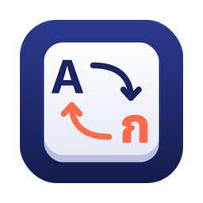

<p align="center">
  
</p>

<h1 align="center">ThaiFix</h1>

<p align="center">
  Typed in the wrong keyboard layout? Press one shortcut and it's fixed.<br>
  พิมพ์ผิดภาษาเพราะลืมสลับแป้น? กดปุ่มเดียว แก้ให้ทันที
</p>

<p align="center">
  <code>l;ylfu</code> &nbsp;→&nbsp; <b>สวัสดี</b> &nbsp;&nbsp;·&nbsp;&nbsp; <code>้ำสสน ไนพสก</code> &nbsp;→&nbsp; <b>hello world</b>
</p>

---

## What it does

ThaiFix is a tiny app for **macOS and Windows**. When you forget to switch between the Thai and English keyboard and end up with gibberish, press **⌥⌘L** (Option + Command + L) on Mac or **Ctrl + Alt + L** on Windows:

- **Fixes only the wrong words.** Correct words in a mixed line are left alone —
  `อัพเดท repo มาให้หน่อย` stays exactly as typed, while `นัดกัน l;ylfu` becomes `นัดกัน สวัสดี`.
- **Works in any app** — LINE, Slack, Chrome, Notes, Word, VS Code…
- **Switches your keyboard** to the language you meant to type.
- **Works with a selection too.** Select any text and press ⌥⌘L to convert just that part.
- **Restores your clipboard** afterwards.
- **100% offline.** Nothing you type ever leaves your Mac.

Changed your mind? Press **⌘Z** to undo.

## Install on Windows

1. **[⬇ Download ThaiFix.exe](https://github.com/phanupongm/thaifix/releases/latest/download/ThaiFix.exe)** (Windows 10/11, no install needed).
2. Double-click it. If Windows SmartScreen shows *"Windows protected your PC"*, click **More info → Run anyway** (the app isn't code-signed yet).
3. ThaiFix lives in the system tray (bottom-right, maybe under the **^** arrow). Right-click it to turn on **start with Windows**.

## Install on Mac

1. **[⬇ Download ThaiFix.zip](https://github.com/phanupongm/thaifix/releases/latest/download/ThaiFix.zip)** (latest release, Apple Silicon + Intel).
2. Unzip it and drag **ThaiFix.app** into **Applications**.
3. Open it. If macOS blocks it, go to **System Settings → Privacy & Security** and click **Open Anyway**.
   If it says the app is *damaged*, run: `xattr -cr /Applications/ThaiFix.app`
4. Allow **Accessibility** access when asked (**System Settings → Privacy & Security → Accessibility → ThaiFix**), then quit and reopen the app.

A small ThaiFix window shows whether everything is ready. You can close it — the app keeps running, with a key icon in the menu bar. Double-click ThaiFix in Applications anytime to bring the window back.

> **Can't see the menu-bar icon?** On MacBooks with a notch it may be hidden behind the camera when the menu bar is crowded. On macOS 26, also check **System Settings → Menu Bar** and make sure ThaiFix is allowed. The shortcut works either way.

> **Updating:** after replacing the app, remove ThaiFix from the Accessibility list and add it again — macOS treats each new build as a different app.

## How it decides what to fix

The Thai Kedmanee and US QWERTY layouts map one key to one character, so conversion itself is a lookup table — no AI or internet needed. The hard part is deciding *which* words to convert. For each word, ThaiFix checks:

| Word looks like | Converted when |
|---|---|
| English letters | it isn't a real English word (bundled dictionary + tech/brand names like *repo, plugin, GitHub*) **and** the Thai it would become is real Thai (splits cleanly into Thai dictionary words) |
| Thai letters | it breaks Thai spelling rules and isn't in the Thai dictionary (e.g. `ำสำ`), or its English equivalent is a real word |
| Glued together | a correct word with a mistyped tail and no space, e.g. `loginsojvp` → `loginหน่อย`, `เสียงในำสำอำืสฟิ` → `เสียงในelevenlab` — only the tail is converted |

URLs, emails and hashtags are never touched.

## Accuracy

Every build runs an automatic test suite on both Mac and Windows (`tests/`). It takes real Thai–English sentences, simulates forgetting to switch layouts in different places (last word, last two words, first word, middle word, glued without a space) and checks the result:

| | Fix accuracy | Correct text wrongly changed |
|---|---|---|
| Main set (151 sentences, 855 cases) | **98.9%** | **0%** |
| Held-out set (40 unseen sentences, 234 cases) | **97.4%** | **0%** |

A build fails if accuracy drops below the thresholds in `tests/thresholds.json`. Add sentences to `tests/corpus.txt` to grow the suite. Known misses are short two-letter Thai words that are also English words (`me` = ทำ, `mu,` = ทีม).

## Why it needs Accessibility permission

To fix text, ThaiFix simulates **⌘C**, converts the text, and simulates **⌘V** — macOS requires Accessibility permission for any app that sends keystrokes. ThaiFix does not log keystrokes, does not run in the background except when you press the shortcut, and makes no network connections.

## Build from source

**Windows:** `dotnet build windows/ThaiFix.csproj -c Release` (.NET SDK; the app targets .NET Framework 4.8, built into Windows 10/11).

**Mac:** Requires Xcode Command Line Tools (`xcode-select --install`).

```bash
bash build.sh
open ThaiFix.app
```

Every push builds both apps on GitHub Actions and runs the accuracy suite. To tune the logic quickly without building, use the Python reference: `python3 tests/gen.py && python3 tests/ref.py tests/inputs.txt out.txt && python3 tests/score.py ref out.txt` — CI checks that the Mac app gives identical results.

## Roadmap

- [ ] Settings window: custom shortcut, launch at login
- [ ] Personal "never convert" word list
- [ ] Pattachote layout
- [ ] More languages (Russian, Hebrew, Arabic, Greek, Korean…)
- [ ] Signed & notarized release
- [x] Windows version
- [ ] Code-signed Windows build

---

## ภาษาไทย

**ThaiFix** คือแอปเล็ก ๆ สำหรับ Mac และ Windows สำหรับแก้ข้อความที่พิมพ์ผิดภาษาเพราะลืมสลับแป้น ไทย/อังกฤษ

**วิธีใช้:** พิมพ์ไปตามปกติ ถ้าเผลอพิมพ์ผิดภาษา ให้กด **Option + Command + L** (Mac) หรือ **Ctrl + Alt + L** (Windows)
- แอปจะแก้เฉพาะคำที่ผิด คำอังกฤษที่ถูกอยู่แล้ว เช่น repo, update, GitHub จะไม่ถูกแตะ
- ถ้าลากเลือกข้อความไว้ จะแปลงเฉพาะส่วนที่เลือก
- แปลงเสร็จแล้วสลับแป้นภาษาให้ด้วย
- ไม่ต้องใช้อินเทอร์เน็ต ข้อความที่พิมพ์ไม่ถูกส่งออกจากเครื่อง
- ถ้าแปลงผิด กด Command + Z เพื่อย้อนกลับ

**Windows:** [⬇ ดาวน์โหลด ThaiFix.exe](https://github.com/phanupongm/thaifix/releases/latest/download/ThaiFix.exe) → ดับเบิลคลิก ถ้าขึ้นหน้าจอสีฟ้า "Windows protected your PC" ให้กด More info → Run anyway

**Mac:** [⬇ ดาวน์โหลด ThaiFix.zip](https://github.com/phanupongm/thaifix/releases/latest/download/ThaiFix.zip) → แตกไฟล์ → ลาก ThaiFix.app ไปไว้ในโฟลเดอร์ Applications จากนั้นเปิดสิทธิ์ Accessibility ให้แอป (ดูรายละเอียดในหัวข้อ Install ด้านบน)

เจอคำที่แปลงผิด หรือคำที่ไม่ควรถูกแปลง? [เปิด issue](../../issues) บอกได้เลย

---

English word list from [word-list](https://github.com/sindresorhus/word-list) by Sindre Sorhus (MIT). Thai word and syllable lists from [PyThaiNLP](https://github.com/PyThaiNLP/pythainlp) (CC0).
